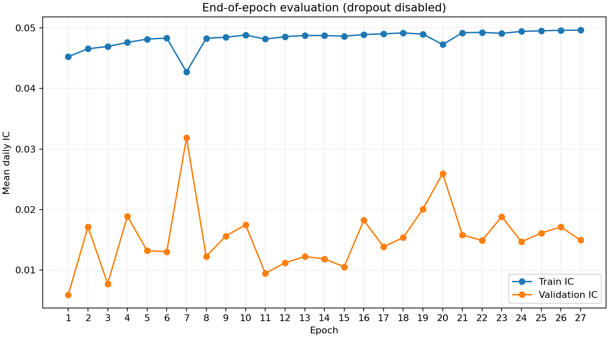
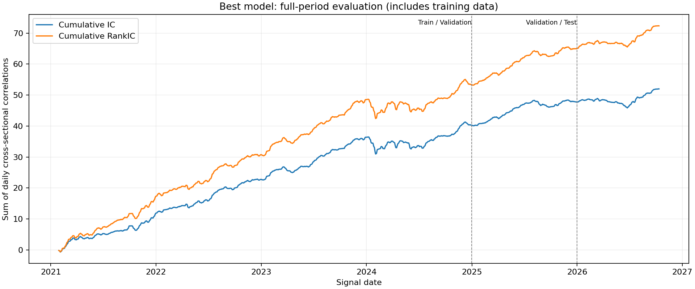

# attention7-3800-lr1e3-wd1e4-seed42-retry1-20261114

Status: **completed** | Exit code: `0`

[Download complete results ZIP](https://github.com/ai-macro-quant/experiment-queue/releases/tag/result-attention7-3800-lr1e3-wd1e4-seed42-retry1-20261114)

ZIP SHA256: `4dff4801491bd79165be4625ff329643d4a7b9b014976464a8afa25372021426`

- [run/epoch_metrics.csv](run__epoch_metrics.csv)

- [run/metrics.json](run__metrics.json)

| Metric | Value |
|---|---:|
| splits.train.mean_ic | 0.0427212 |
| splits.train.mean_rank_ic | 0.0565792 |
| splits.train.valid_ic_days | 945 |
| splits.train.cumulative_ic | 40.3715 |
| splits.train.cumulative_rank_ic | 53.4673 |
| splits.valid.mean_ic | 0.0318506 |
| splits.valid.mean_rank_ic | 0.0489617 |
| splits.valid.valid_ic_days | 238 |
| splits.valid.cumulative_ic | 7.58044 |
| splits.valid.cumulative_rank_ic | 11.6529 |
| splits.test.mean_ic | 0.0227952 |
| splits.test.mean_rank_ic | 0.0402962 |
| splits.test.valid_ic_days | 179 |
| splits.test.cumulative_ic | 4.08034 |
| splits.test.cumulative_rank_ic | 7.21302 |
| splits.full.mean_ic | 0.037759 |
| splits.full.mean_rank_ic | 0.052532 |
| splits.full.valid_ic_days | 1377 |
| splits.full.cumulative_ic | 51.9942 |
| splits.full.cumulative_rank_ic | 72.3366 |
