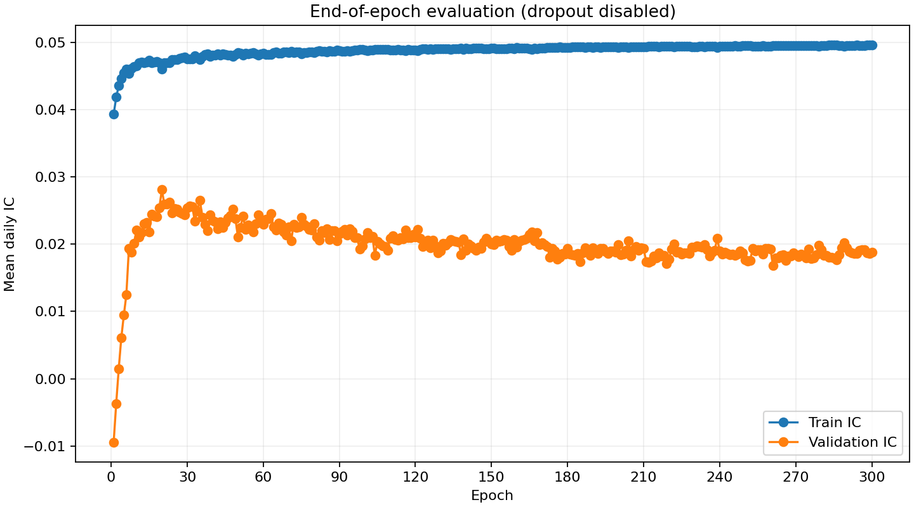
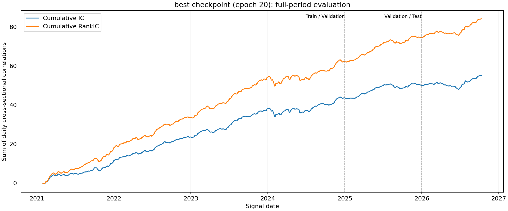
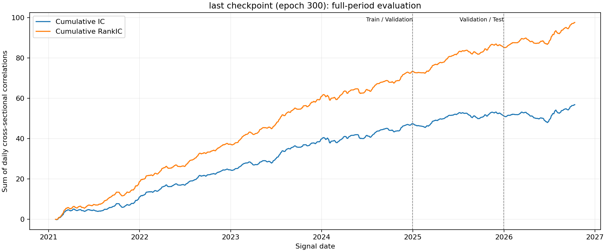

# attention7-3800-lr1e4-wd1e2-seed42-300-20261124-143907

Status: **completed** | Exit code: `0`

[Download complete results ZIP](https://github.com/ai-macro-quant/experiment-queue/releases/tag/result-attention7-3800-lr1e4-wd1e2-seed42-300-20261124-143907)

ZIP SHA256: `e49106768d2fb12d68504a67c173c532a2133bb4b9f4b3d5dcf29932d6f5a01e`

- [run/epoch_metrics.csv](run__epoch_metrics.csv)

- [run/last_epoch/metrics.json](run__last_epoch__metrics.json)

| Metric | Value |
|---|---:|
| splits.train.mean_ic | 0.0496072 |
| splits.train.mean_rank_ic | 0.0769071 |
| splits.train.valid_ic_days | 945 |
| splits.train.cumulative_ic | 46.8788 |
| splits.train.cumulative_rank_ic | 72.6772 |
| splits.valid.mean_ic | 0.0188511 |
| splits.valid.mean_rank_ic | 0.0528312 |
| splits.valid.valid_ic_days | 238 |
| splits.valid.cumulative_ic | 4.48656 |
| splits.valid.cumulative_rank_ic | 12.5738 |
| splits.test.mean_ic | 0.0267372 |
| splits.test.mean_rank_ic | 0.06323 |
| splits.test.valid_ic_days | 179 |
| splits.test.cumulative_ic | 4.78596 |
| splits.test.cumulative_rank_ic | 11.3182 |
| splits.full.mean_ic | 0.0412852 |
| splits.full.mean_rank_ic | 0.070898 |
| splits.full.valid_ic_days | 1377 |
| splits.full.cumulative_ic | 56.8497 |
| splits.full.cumulative_rank_ic | 97.6265 |

- [run/metrics.json](run__metrics.json)

| Metric | Value |
|---|---:|
| splits.train.mean_ic | 0.0460288 |
| splits.train.mean_rank_ic | 0.0656849 |
| splits.train.valid_ic_days | 945 |
| splits.train.cumulative_ic | 43.4972 |
| splits.train.cumulative_rank_ic | 62.0722 |
| splits.valid.mean_ic | 0.0281078 |
| splits.valid.mean_rank_ic | 0.052417 |
| splits.valid.valid_ic_days | 238 |
| splits.valid.cumulative_ic | 6.68965 |
| splits.valid.cumulative_rank_ic | 12.4752 |
| splits.test.mean_ic | 0.0270325 |
| splits.test.mean_rank_ic | 0.0518899 |
| splits.test.valid_ic_days | 179 |
| splits.test.cumulative_ic | 4.83882 |
| splits.test.cumulative_rank_ic | 9.2883 |
| splits.full.mean_ic | 0.0400911 |
| splits.full.mean_rank_ic | 0.0611205 |
| splits.full.valid_ic_days | 1377 |
| splits.full.cumulative_ic | 55.2054 |
| splits.full.cumulative_rank_ic | 84.163 |
