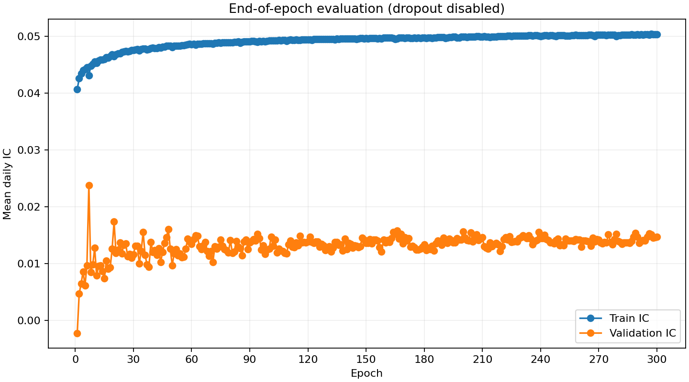
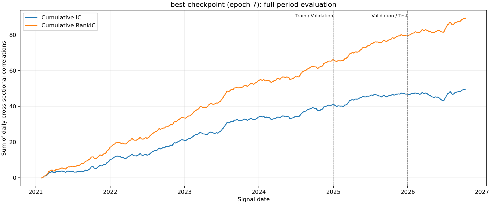
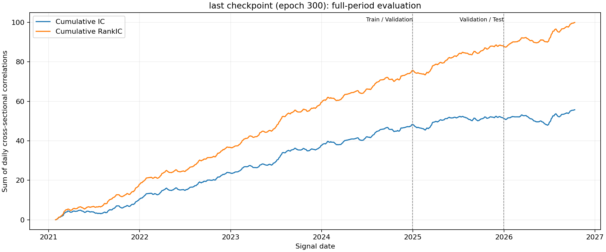

# attention7-zz1000-lr1e3-wd1e4-seed42-300-20261124-130948

Status: **completed** | Exit code: `0`

[Download complete results ZIP](https://github.com/ai-macro-quant/experiment-queue/releases/tag/result-attention7-zz1000-lr1e3-wd1e4-seed42-300-20261124-130948)

ZIP SHA256: `2b1f36958b472d92aec7490989003ff574023792b84dd07f8f93e865f4d37d36`

- [run/epoch_metrics.csv](run__epoch_metrics.csv)

- [run/last_epoch/metrics.json](run__last_epoch__metrics.json)

| Metric | Value |
|---|---:|
| splits.train.mean_ic | 0.0503171 |
| splits.train.mean_rank_ic | 0.078971 |
| splits.train.valid_ic_days | 945 |
| splits.train.cumulative_ic | 47.5497 |
| splits.train.cumulative_rank_ic | 74.6276 |
| splits.valid.mean_ic | 0.0147112 |
| splits.valid.mean_rank_ic | 0.0528032 |
| splits.valid.valid_ic_days | 238 |
| splits.valid.cumulative_ic | 3.50126 |
| splits.valid.cumulative_rank_ic | 12.5672 |
| splits.test.mean_ic | 0.0220904 |
| splits.test.mean_rank_ic | 0.0642631 |
| splits.test.valid_ic_days | 179 |
| splits.test.cumulative_ic | 3.95417 |
| splits.test.cumulative_rank_ic | 11.5031 |
| splits.full.mean_ic | 0.0404623 |
| splits.full.mean_rank_ic | 0.0725738 |
| splits.full.valid_ic_days | 1377 |
| splits.full.cumulative_ic | 55.7166 |
| splits.full.cumulative_rank_ic | 99.9341 |

- [run/metrics.json](run__metrics.json)

| Metric | Value |
|---|---:|
| splits.train.mean_ic | 0.0431238 |
| splits.train.mean_rank_ic | 0.0693322 |
| splits.train.valid_ic_days | 945 |
| splits.train.cumulative_ic | 40.752 |
| splits.train.cumulative_rank_ic | 65.519 |
| splits.valid.mean_ic | 0.0238039 |
| splits.valid.mean_rank_ic | 0.0575196 |
| splits.valid.valid_ic_days | 238 |
| splits.valid.cumulative_ic | 5.66533 |
| splits.valid.cumulative_rank_ic | 13.6897 |
| splits.test.mean_ic | 0.0138598 |
| splits.test.mean_rank_ic | 0.0505733 |
| splits.test.valid_ic_days | 179 |
| splits.test.cumulative_ic | 2.48091 |
| splits.test.cumulative_rank_ic | 9.05262 |
| splits.full.mean_ic | 0.0360375 |
| splits.full.mean_rank_ic | 0.0649058 |
| splits.full.valid_ic_days | 1377 |
| splits.full.cumulative_ic | 49.6237 |
| splits.full.cumulative_rank_ic | 89.3753 |
