# zz1000-master-v0-to-v6-lr1e4-wd1e2-p20-20261114-182131

Status: **completed** | Exit code: `0`

[Download complete results ZIP](https://github.com/ai-macro-quant/experiment-queue/releases/tag/result-zz1000-master-v0-to-v6-lr1e4-wd1e2-p20-20261114-182131)

ZIP SHA256: `fbcd773c346e20868cf727ca6c6a8712c68da55b55f051b7ccbf420531691e95`

- [summary.csv](summary.csv)

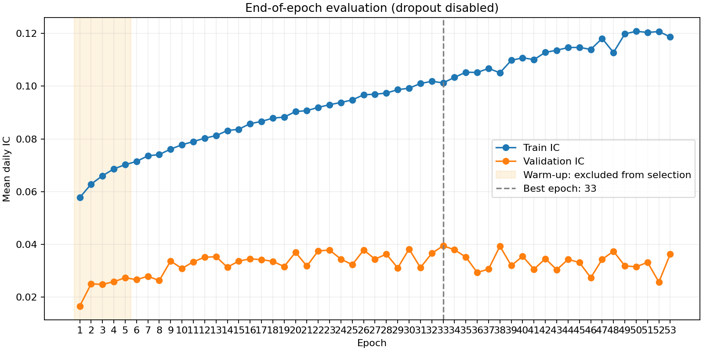

- [trials/V0_MASTER/attempt_001/epoch_metrics.csv](trials__V0_MASTER__attempt_001__epoch_metrics.csv)

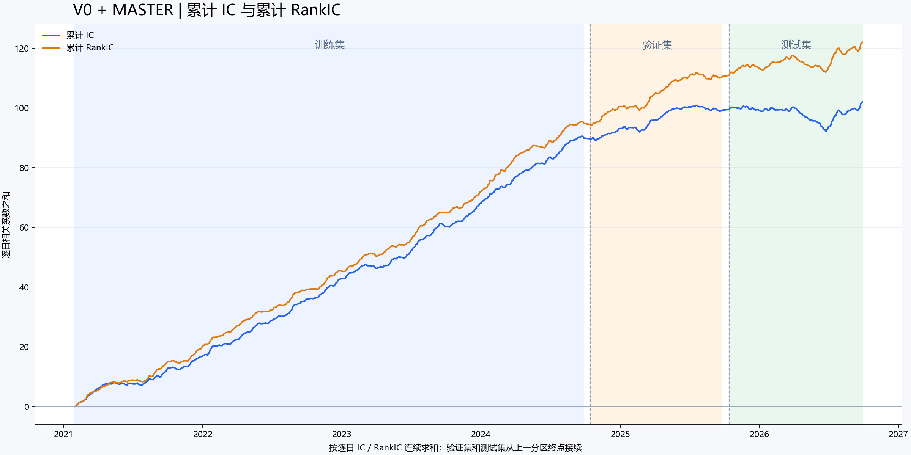

- [trials/V0_MASTER/attempt_001/metrics.json](trials__V0_MASTER__attempt_001__metrics.json)

| Metric | Value |
|---|---:|
| splits.train.mean_ic | 0.101261 |
| splits.train.mean_rank_ic | 0.106775 |
| splits.valid.mean_ic | 0.0394999 |
| splits.valid.mean_rank_ic | 0.0664804 |
| splits.test.mean_ic | 0.01156 |
| splits.test.mean_rank_ic | 0.0483209 |

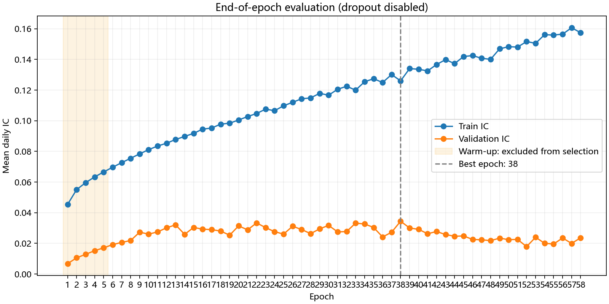

- [trials/V1_MASTER/attempt_001/epoch_metrics.csv](trials__V1_MASTER__attempt_001__epoch_metrics.csv)

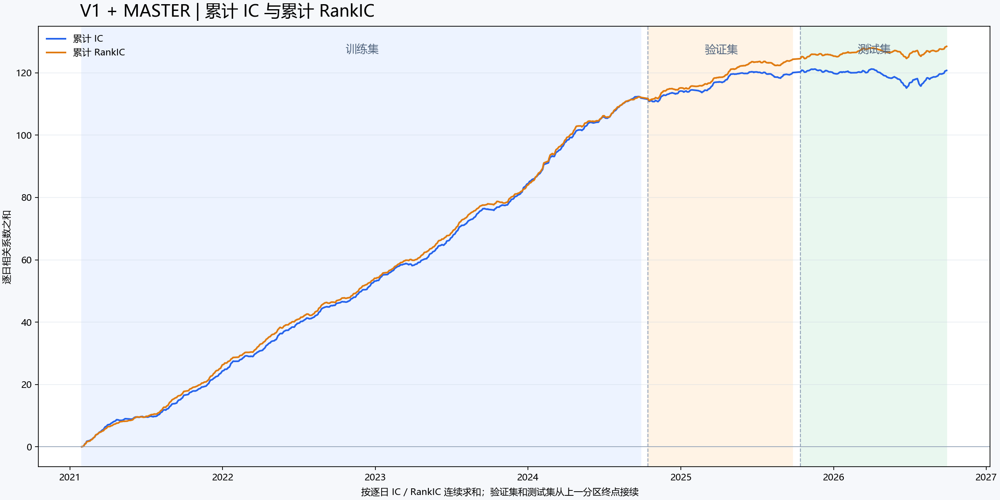

- [trials/V1_MASTER/attempt_001/metrics.json](trials__V1_MASTER__attempt_001__metrics.json)

| Metric | Value |
|---|---:|
| splits.train.mean_ic | 0.126019 |
| splits.train.mean_rank_ic | 0.126255 |
| splits.valid.mean_ic | 0.0344504 |
| splits.valid.mean_rank_ic | 0.0515933 |
| splits.test.mean_ic | 0.00287054 |
| splits.test.mean_rank_ic | 0.0174497 |

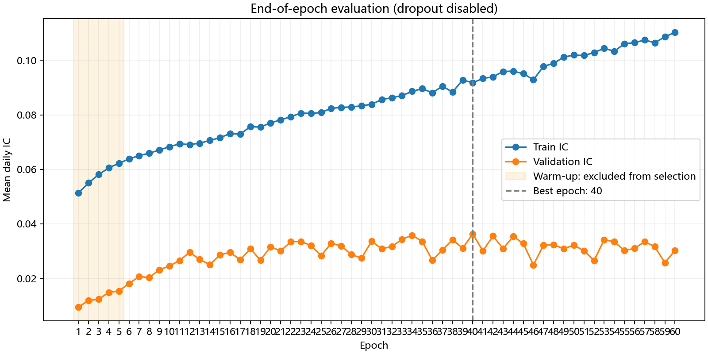

- [trials/V2_MASTER/attempt_001/epoch_metrics.csv](trials__V2_MASTER__attempt_001__epoch_metrics.csv)

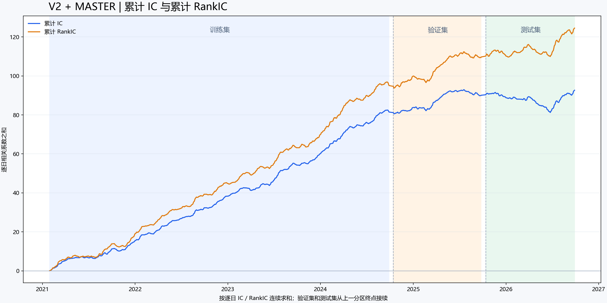

- [trials/V2_MASTER/attempt_001/metrics.json](trials__V2_MASTER__attempt_001__metrics.json)

| Metric | Value |
|---|---:|
| splits.train.mean_ic | 0.0917582 |
| splits.train.mean_rank_ic | 0.107056 |
| splits.valid.mean_ic | 0.0363187 |
| splits.valid.mean_rank_ic | 0.0618275 |
| splits.test.mean_ic | 0.0108683 |
| splits.test.mean_rank_ic | 0.0625222 |

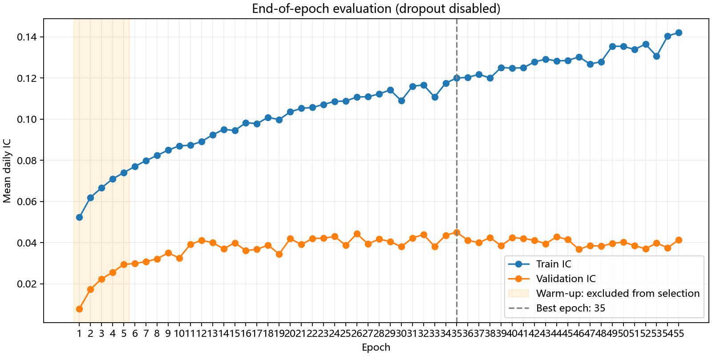

- [trials/V3_MASTER/attempt_001/epoch_metrics.csv](trials__V3_MASTER__attempt_001__epoch_metrics.csv)

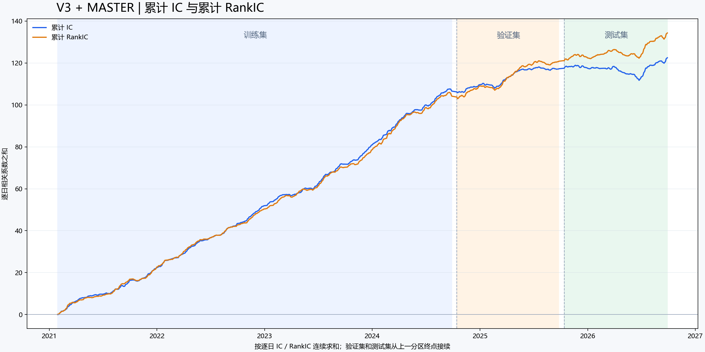

- [trials/V3_MASTER/attempt_001/metrics.json](trials__V3_MASTER__attempt_001__metrics.json)

| Metric | Value |
|---|---:|
| splits.train.mean_ic | 0.120014 |
| splits.train.mean_rank_ic | 0.117309 |
| splits.valid.mean_ic | 0.0450647 |
| splits.valid.mean_rank_ic | 0.0703576 |
| splits.test.mean_ic | 0.0221318 |
| splits.test.mean_rank_ic | 0.0568815 |

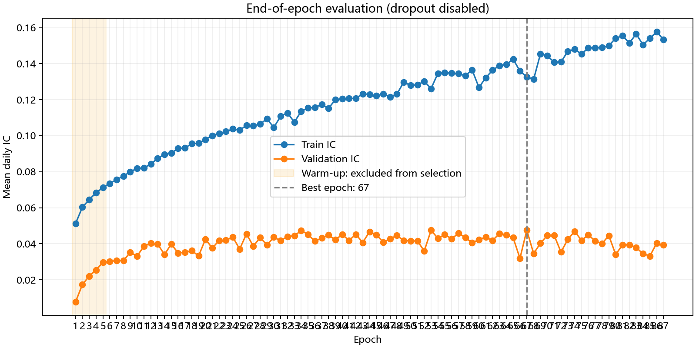

- [trials/V4_MASTER/attempt_001/epoch_metrics.csv](trials__V4_MASTER__attempt_001__epoch_metrics.csv)

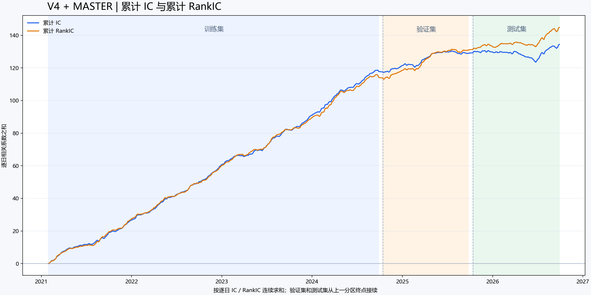

- [trials/V4_MASTER/attempt_001/metrics.json](trials__V4_MASTER__attempt_001__metrics.json)

| Metric | Value |
|---|---:|
| splits.train.mean_ic | 0.13266 |
| splits.train.mean_rank_ic | 0.128548 |
| splits.valid.mean_ic | 0.0475511 |
| splits.valid.mean_rank_ic | 0.0713631 |
| splits.test.mean_ic | 0.0227739 |
| splits.test.mean_rank_ic | 0.0582976 |

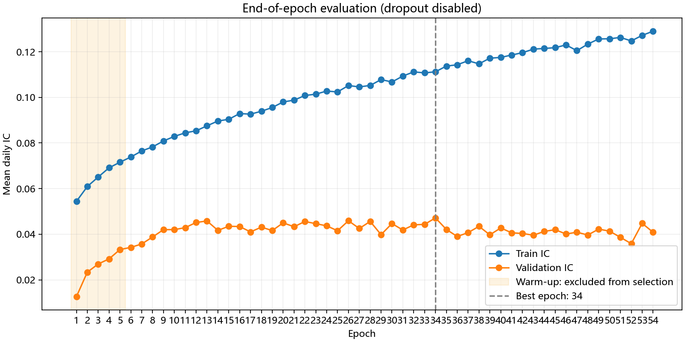

- [trials/V5_MASTER/attempt_001/epoch_metrics.csv](trials__V5_MASTER__attempt_001__epoch_metrics.csv)

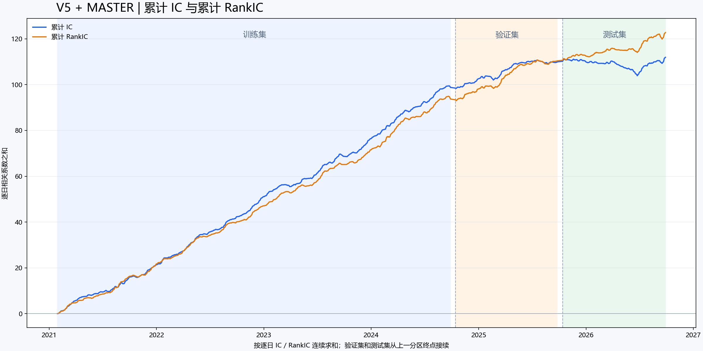

- [trials/V5_MASTER/attempt_001/metrics.json](trials__V5_MASTER__attempt_001__metrics.json)

| Metric | Value |
|---|---:|
| splits.train.mean_ic | 0.111226 |
| splits.train.mean_rank_ic | 0.105522 |
| splits.valid.mean_ic | 0.047157 |
| splits.valid.mean_rank_ic | 0.0703175 |
| splits.test.mean_ic | 0.00832549 |
| splits.test.mean_rank_ic | 0.0521139 |

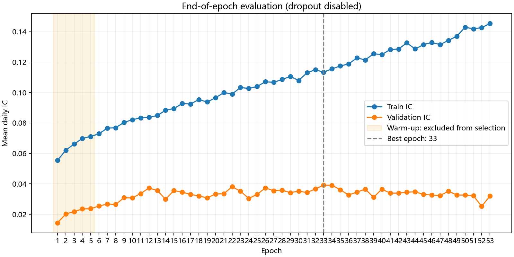

- [trials/V6_MASTER/attempt_001/epoch_metrics.csv](trials__V6_MASTER__attempt_001__epoch_metrics.csv)

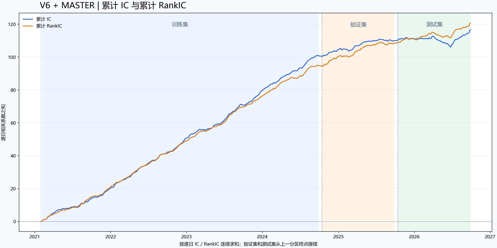

- [trials/V6_MASTER/attempt_001/metrics.json](trials__V6_MASTER__attempt_001__metrics.json)

| Metric | Value |
|---|---:|
| splits.train.mean_ic | 0.113426 |
| splits.train.mean_rank_ic | 0.106715 |
| splits.valid.mean_ic | 0.0391594 |
| splits.valid.mean_rank_ic | 0.0576249 |
| splits.test.mean_ic | 0.0278043 |
| splits.test.mean_rank_ic | 0.0519081 |
