# zz1000-master-v0-to-v6-lr1e4-wd1e3-p15-20261118-221758

Status: **completed** | Exit code: `0`

[Download complete results ZIP](https://github.com/ai-macro-quant/experiment-queue/releases/tag/result-zz1000-master-v0-to-v6-lr1e4-wd1e3-p15-20261118-221758)

ZIP SHA256: `1d3256594d90545a00b57d8c823c59dea9537cf293188169d505bcbf299a7db0`

- [run/summary.csv](run__summary.csv)

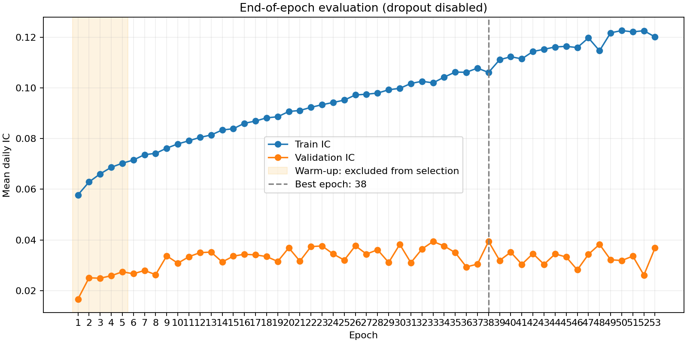

- [run/trials/V0_MASTER/attempt_001/epoch_metrics.csv](run__trials__V0_MASTER__attempt_001__epoch_metrics.csv)

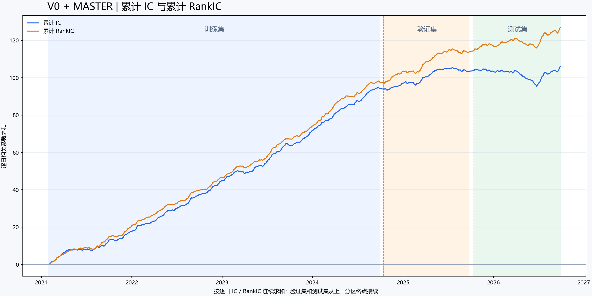

- [run/trials/V0_MASTER/attempt_001/metrics.json](run__trials__V0_MASTER__attempt_001__metrics.json)

| Metric | Value |
|---|---:|
| splits.train.mean_ic | 0.106074 |
| splits.train.mean_rank_ic | 0.110044 |
| splits.valid.mean_ic | 0.0394286 |
| splits.valid.mean_rank_ic | 0.0689255 |
| splits.test.mean_ic | 0.0107113 |
| splits.test.mean_rank_ic | 0.0543429 |

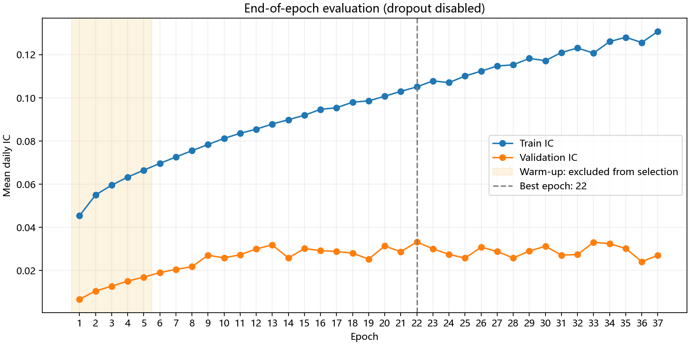

- [run/trials/V1_MASTER/attempt_001/epoch_metrics.csv](run__trials__V1_MASTER__attempt_001__epoch_metrics.csv)

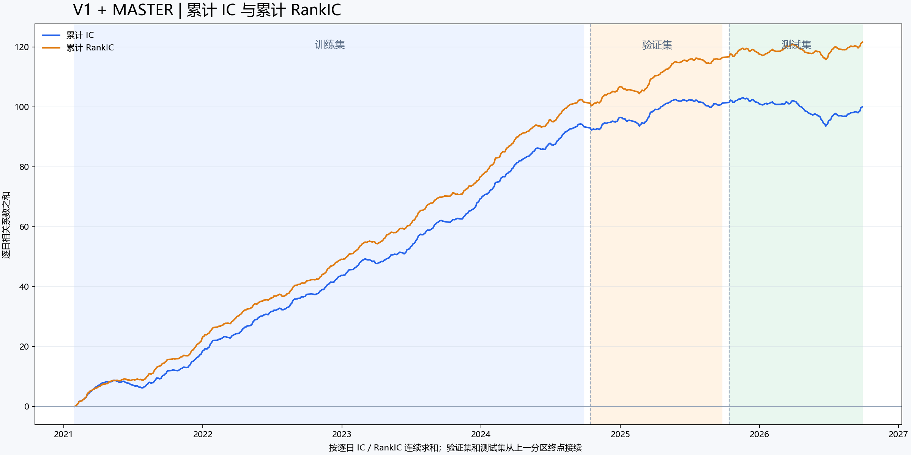

- [run/trials/V1_MASTER/attempt_001/metrics.json](run__trials__V1_MASTER__attempt_001__metrics.json)

| Metric | Value |
|---|---:|
| splits.train.mean_ic | 0.105106 |
| splits.train.mean_rank_ic | 0.114391 |
| splits.valid.mean_ic | 0.0332554 |
| splits.valid.mean_rank_ic | 0.0626757 |
| splits.test.mean_ic | -0.00512598 |
| splits.test.mean_rank_ic | 0.0215753 |

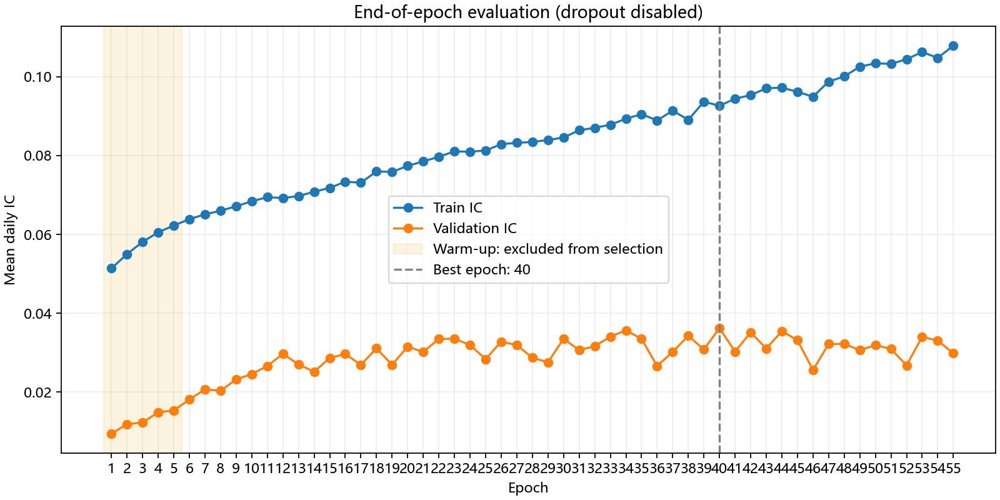

- [run/trials/V2_MASTER/attempt_001/epoch_metrics.csv](run__trials__V2_MASTER__attempt_001__epoch_metrics.csv)

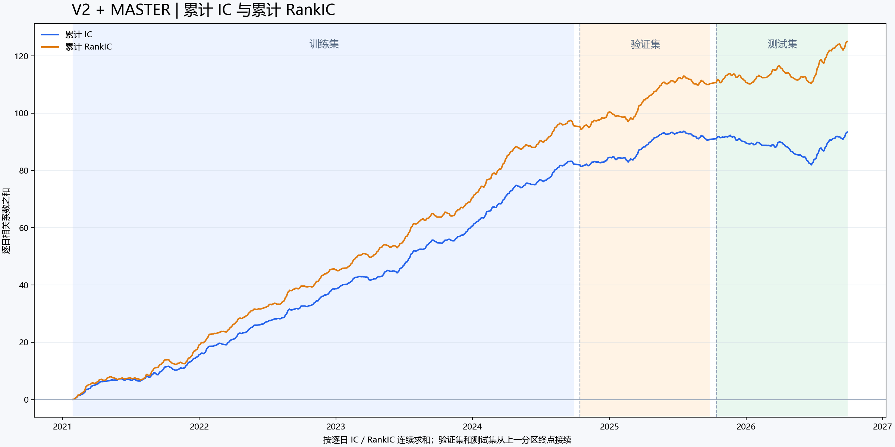

- [run/trials/V2_MASTER/attempt_001/metrics.json](run__trials__V2_MASTER__attempt_001__metrics.json)

| Metric | Value |
|---|---:|
| splits.train.mean_ic | 0.0926305 |
| splits.train.mean_rank_ic | 0.10769 |
| splits.valid.mean_ic | 0.0362387 |
| splits.valid.mean_rank_ic | 0.06182 |
| splits.test.mean_ic | 0.0108105 |
| splits.test.mean_rank_ic | 0.062314 |

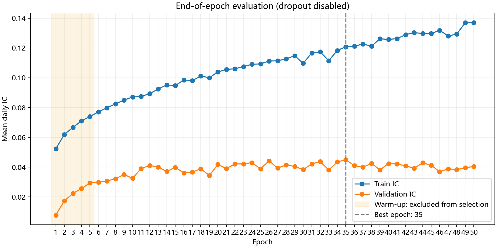

- [run/trials/V3_MASTER/attempt_001/epoch_metrics.csv](run__trials__V3_MASTER__attempt_001__epoch_metrics.csv)

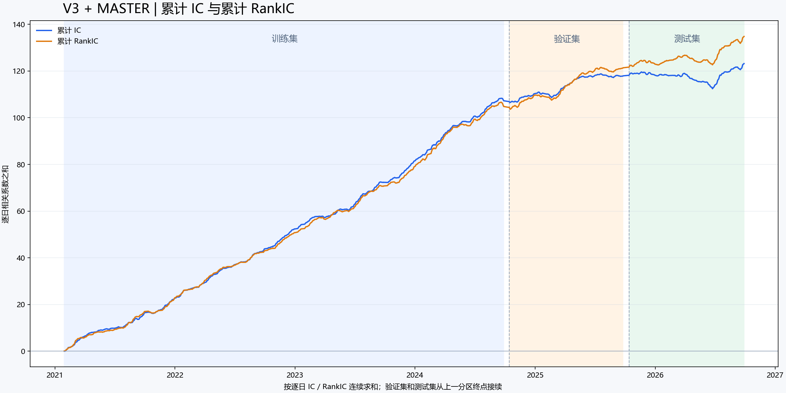

- [run/trials/V3_MASTER/attempt_001/metrics.json](run__trials__V3_MASTER__attempt_001__metrics.json)

| Metric | Value |
|---|---:|
| splits.train.mean_ic | 0.12079 |
| splits.train.mean_rank_ic | 0.118025 |
| splits.valid.mean_ic | 0.0450142 |
| splits.valid.mean_rank_ic | 0.0699411 |
| splits.test.mean_ic | 0.0221465 |
| splits.test.mean_rank_ic | 0.0566094 |

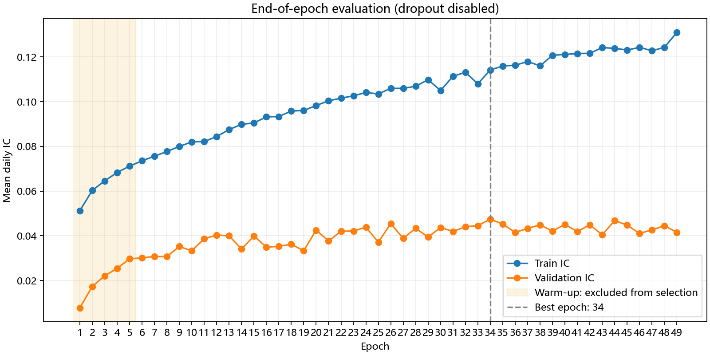

- [run/trials/V4_MASTER/attempt_001/epoch_metrics.csv](run__trials__V4_MASTER__attempt_001__epoch_metrics.csv)

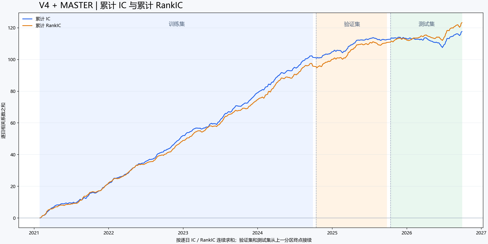

- [run/trials/V4_MASTER/attempt_001/metrics.json](run__trials__V4_MASTER__attempt_001__metrics.json)

| Metric | Value |
|---|---:|
| splits.train.mean_ic | 0.114167 |
| splits.train.mean_rank_ic | 0.10791 |
| splits.valid.mean_ic | 0.0474484 |
| splits.valid.mean_rank_ic | 0.0630113 |
| splits.test.mean_ic | 0.0211717 |
| splits.test.mean_rank_ic | 0.0527655 |

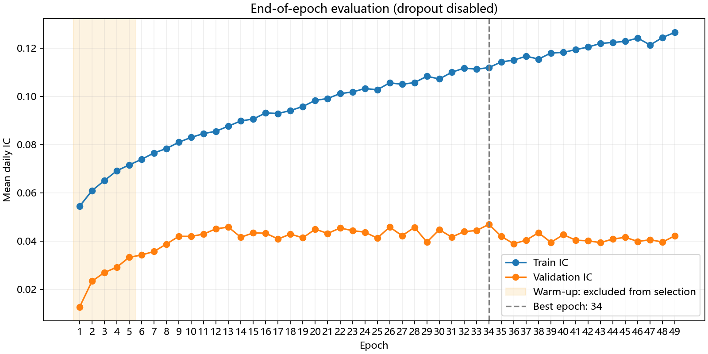

- [run/trials/V5_MASTER/attempt_001/epoch_metrics.csv](run__trials__V5_MASTER__attempt_001__epoch_metrics.csv)

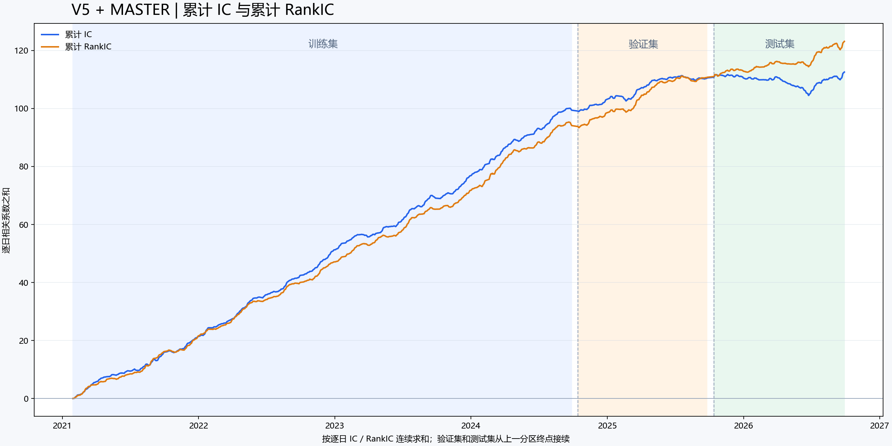

- [run/trials/V5_MASTER/attempt_001/metrics.json](run__trials__V5_MASTER__attempt_001__metrics.json)

| Metric | Value |
|---|---:|
| splits.train.mean_ic | 0.111921 |
| splits.train.mean_rank_ic | 0.105958 |
| splits.valid.mean_ic | 0.0469397 |
| splits.valid.mean_rank_ic | 0.0702263 |
| splits.test.mean_ic | 0.00853053 |
| splits.test.mean_rank_ic | 0.052196 |

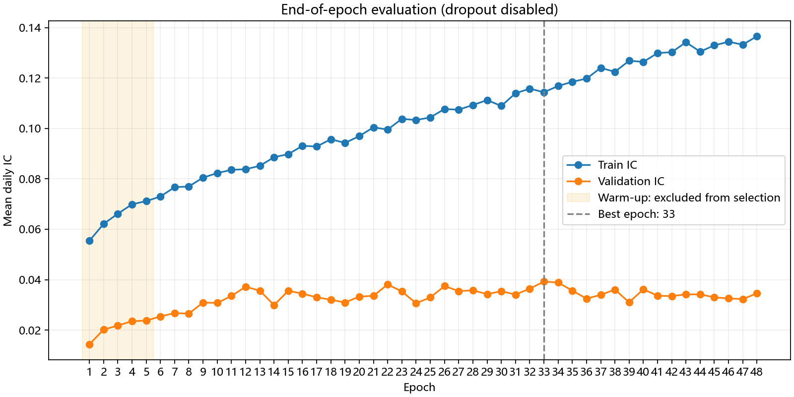

- [run/trials/V6_MASTER/attempt_001/epoch_metrics.csv](run__trials__V6_MASTER__attempt_001__epoch_metrics.csv)

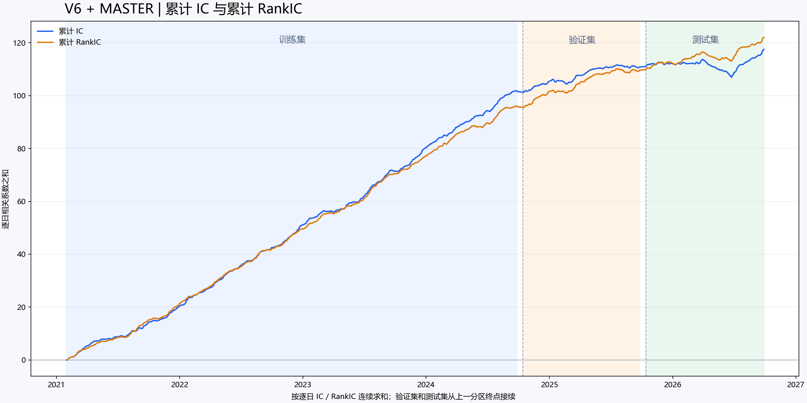

- [run/trials/V6_MASTER/attempt_001/metrics.json](run__trials__V6_MASTER__attempt_001__metrics.json)

| Metric | Value |
|---|---:|
| splits.train.mean_ic | 0.114368 |
| splits.train.mean_rank_ic | 0.107881 |
| splits.valid.mean_ic | 0.0392344 |
| splits.valid.mean_rank_ic | 0.0584765 |
| splits.test.mean_ic | 0.027991 |
| splits.test.mean_rank_ic | 0.0522751 |
