# zz1000-master-v0-to-v6-lr1e4-wd1e4-p15-20261118-214145

Status: **completed** | Exit code: `0`

[Download complete results ZIP](https://github.com/ai-macro-quant/experiment-queue/releases/tag/result-zz1000-master-v0-to-v6-lr1e4-wd1e4-p15-20261118-214145)

ZIP SHA256: `4c8f216c7bc59caa1560c37a7961841738d5a57d719d9a9125f46b7f11bfc8d2`

- [run/summary.csv](run__summary.csv)

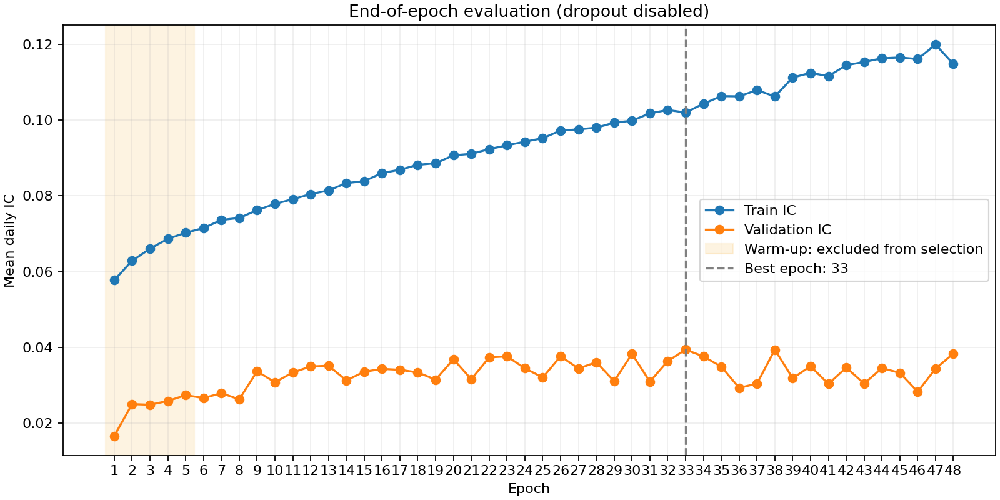

- [run/trials/V0_MASTER/attempt_001/epoch_metrics.csv](run__trials__V0_MASTER__attempt_001__epoch_metrics.csv)

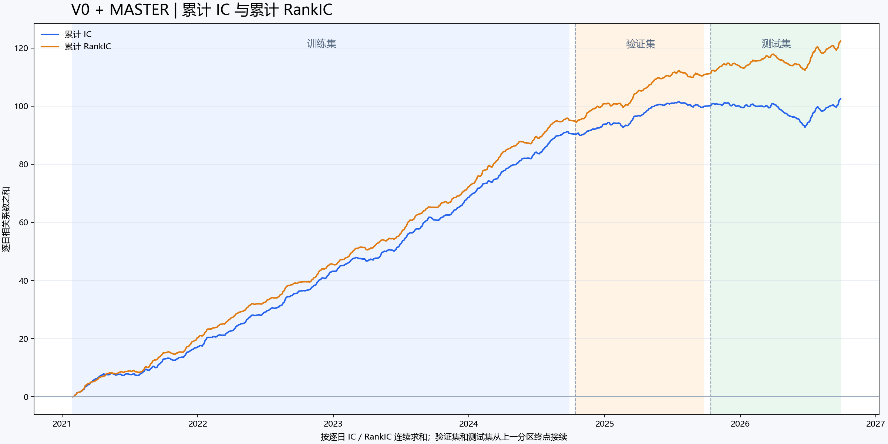

- [run/trials/V0_MASTER/attempt_001/metrics.json](run__trials__V0_MASTER__attempt_001__metrics.json)

| Metric | Value |
|---|---:|
| splits.train.mean_ic | 0.102008 |
| splits.train.mean_rank_ic | 0.107168 |
| splits.valid.mean_ic | 0.0394451 |
| splits.valid.mean_rank_ic | 0.0663503 |
| splits.test.mean_ic | 0.010905 |
| splits.test.mean_rank_ic | 0.048337 |

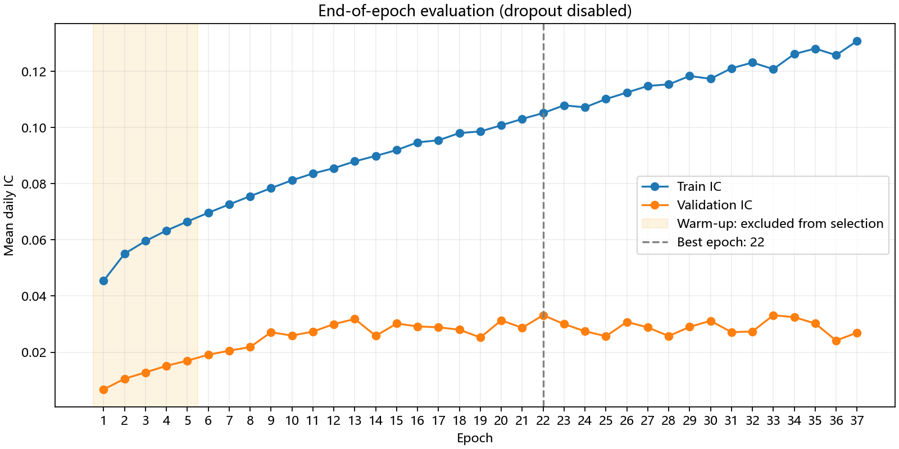

- [run/trials/V1_MASTER/attempt_001/epoch_metrics.csv](run__trials__V1_MASTER__attempt_001__epoch_metrics.csv)

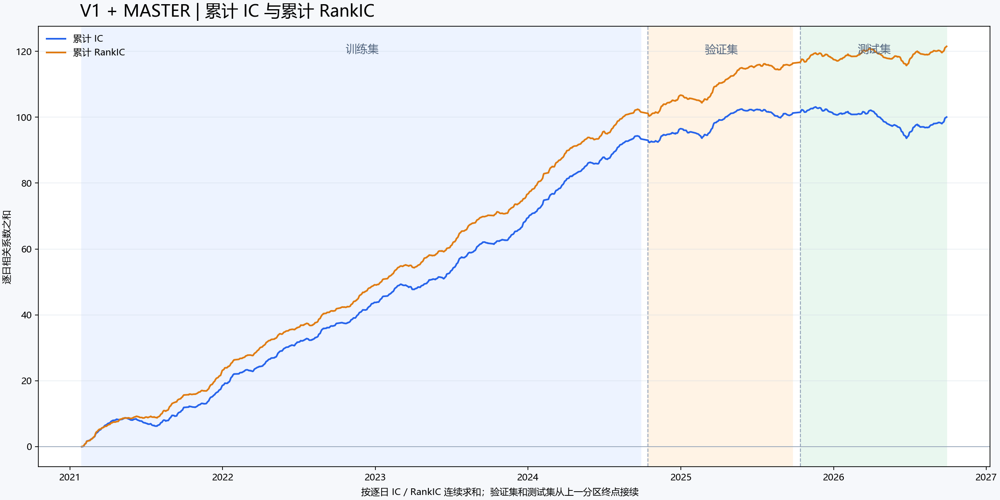

- [run/trials/V1_MASTER/attempt_001/metrics.json](run__trials__V1_MASTER__attempt_001__metrics.json)

| Metric | Value |
|---|---:|
| splits.train.mean_ic | 0.10517 |
| splits.train.mean_rank_ic | 0.114357 |
| splits.valid.mean_ic | 0.0331716 |
| splits.valid.mean_rank_ic | 0.0625787 |
| splits.test.mean_ic | -0.00513994 |
| splits.test.mean_rank_ic | 0.0215139 |

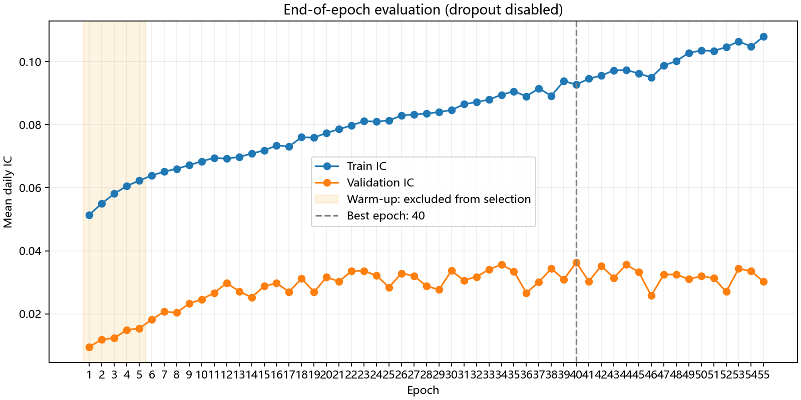

- [run/trials/V2_MASTER/attempt_001/epoch_metrics.csv](run__trials__V2_MASTER__attempt_001__epoch_metrics.csv)

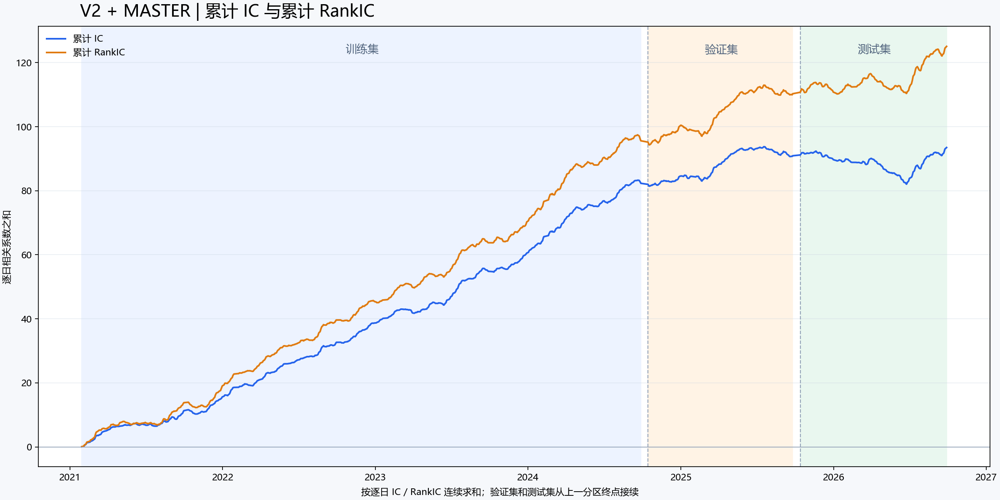

- [run/trials/V2_MASTER/attempt_001/metrics.json](run__trials__V2_MASTER__attempt_001__metrics.json)

| Metric | Value |
|---|---:|
| splits.train.mean_ic | 0.0926972 |
| splits.train.mean_rank_ic | 0.107649 |
| splits.valid.mean_ic | 0.0363 |
| splits.valid.mean_rank_ic | 0.0620124 |
| splits.test.mean_ic | 0.0108554 |
| splits.test.mean_rank_ic | 0.0623888 |

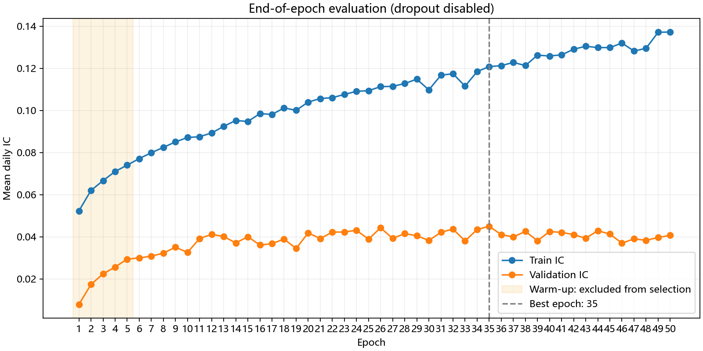

- [run/trials/V3_MASTER/attempt_001/epoch_metrics.csv](run__trials__V3_MASTER__attempt_001__epoch_metrics.csv)

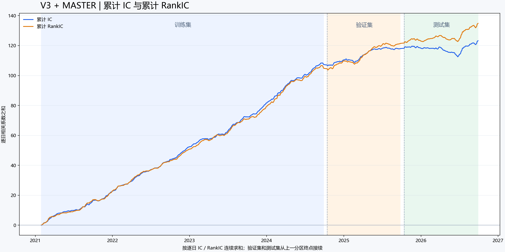

- [run/trials/V3_MASTER/attempt_001/metrics.json](run__trials__V3_MASTER__attempt_001__metrics.json)

| Metric | Value |
|---|---:|
| splits.train.mean_ic | 0.120858 |
| splits.train.mean_rank_ic | 0.118081 |
| splits.valid.mean_ic | 0.0450007 |
| splits.valid.mean_rank_ic | 0.0699547 |
| splits.test.mean_ic | 0.0221821 |
| splits.test.mean_rank_ic | 0.0564882 |

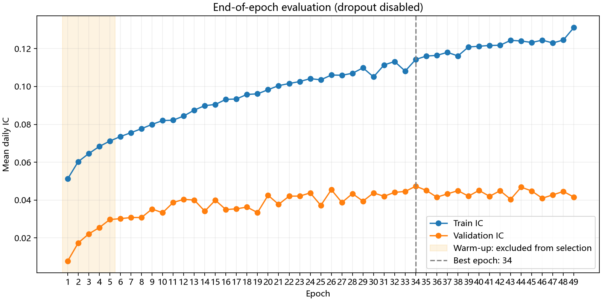

- [run/trials/V4_MASTER/attempt_001/epoch_metrics.csv](run__trials__V4_MASTER__attempt_001__epoch_metrics.csv)

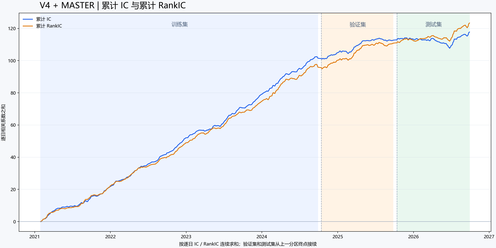

- [run/trials/V4_MASTER/attempt_001/metrics.json](run__trials__V4_MASTER__attempt_001__metrics.json)

| Metric | Value |
|---|---:|
| splits.train.mean_ic | 0.114315 |
| splits.train.mean_rank_ic | 0.108044 |
| splits.valid.mean_ic | 0.0473078 |
| splits.valid.mean_rank_ic | 0.0628851 |
| splits.test.mean_ic | 0.0212132 |
| splits.test.mean_rank_ic | 0.0528167 |

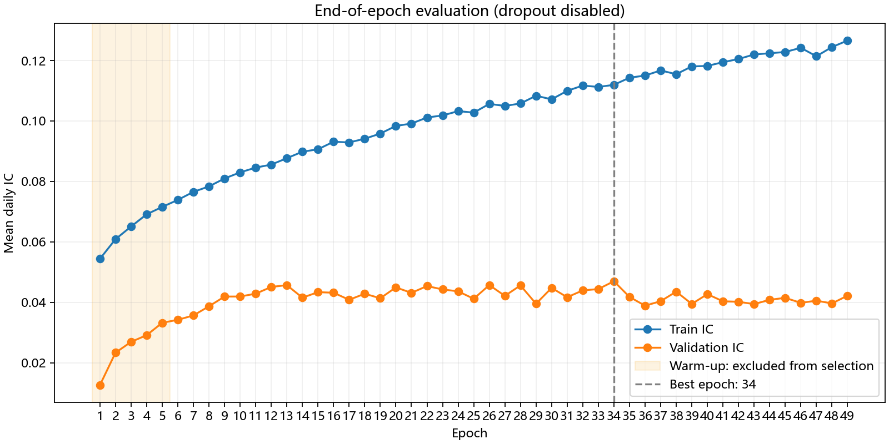

- [run/trials/V5_MASTER/attempt_001/epoch_metrics.csv](run__trials__V5_MASTER__attempt_001__epoch_metrics.csv)

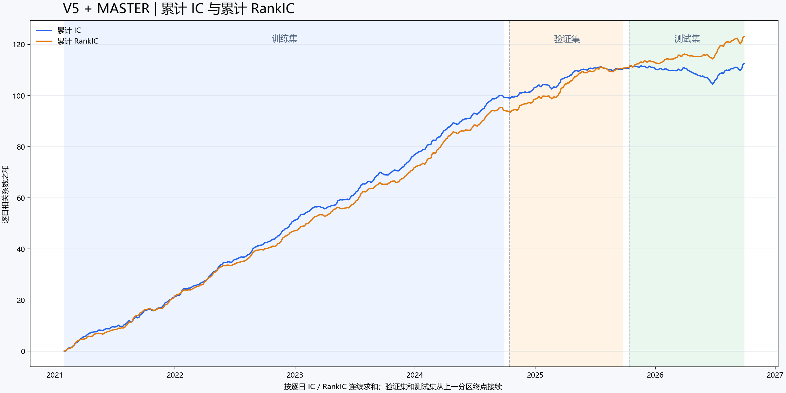

- [run/trials/V5_MASTER/attempt_001/metrics.json](run__trials__V5_MASTER__attempt_001__metrics.json)

| Metric | Value |
|---|---:|
| splits.train.mean_ic | 0.111943 |
| splits.train.mean_rank_ic | 0.106053 |
| splits.valid.mean_ic | 0.0469994 |
| splits.valid.mean_rank_ic | 0.0700535 |
| splits.test.mean_ic | 0.00837052 |
| splits.test.mean_rank_ic | 0.0522493 |

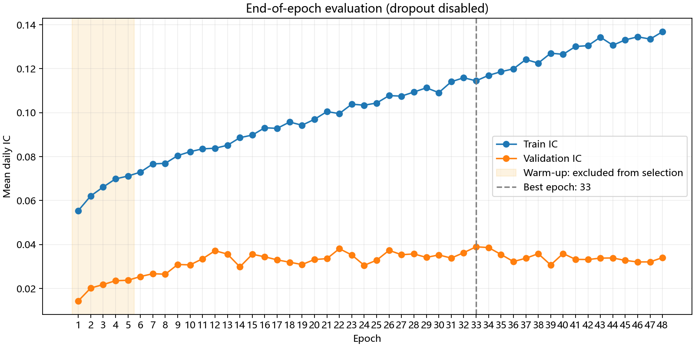

- [run/trials/V6_MASTER/attempt_001/epoch_metrics.csv](run__trials__V6_MASTER__attempt_001__epoch_metrics.csv)

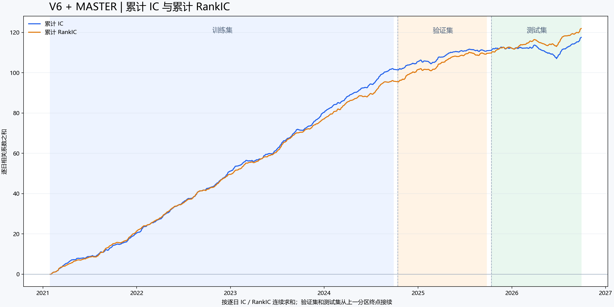

- [run/trials/V6_MASTER/attempt_001/metrics.json](run__trials__V6_MASTER__attempt_001__metrics.json)

| Metric | Value |
|---|---:|
| splits.train.mean_ic | 0.114498 |
| splits.train.mean_rank_ic | 0.107865 |
| splits.valid.mean_ic | 0.0389858 |
| splits.valid.mean_rank_ic | 0.058278 |
| splits.test.mean_ic | 0.0279211 |
| splits.test.mean_rank_ic | 0.0521272 |
