# zz1000-master-v0-to-v6-lr5e3-wd1e2-p15-20261125-194456

Status: **completed** | Exit code: `0`

[Download complete results ZIP](https://github.com/ai-macro-quant/experiment-queue/releases/tag/result-zz1000-master-v0-to-v6-lr5e3-wd1e2-p15-20261125-194456)

ZIP SHA256: `933401aa6b08ba1eca86ab47d2563f3a8a7341301cc7f5ce39f03e4929fcd2f5`

- [run/summary.csv](run__summary.csv)

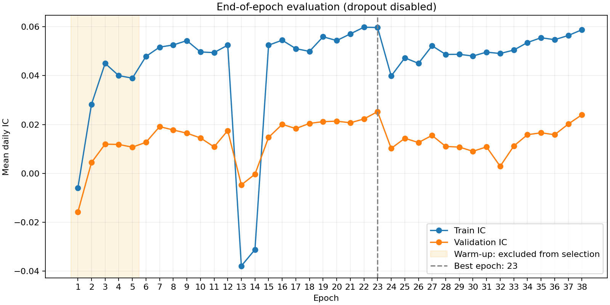

- [run/trials/V0_MASTER/attempt_001/epoch_metrics.csv](run__trials__V0_MASTER__attempt_001__epoch_metrics.csv)

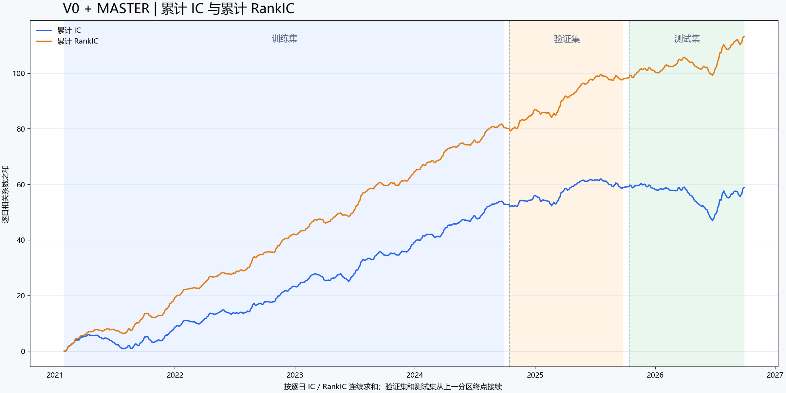

- [run/trials/V0_MASTER/attempt_001/metrics.json](run__trials__V0_MASTER__attempt_001__metrics.json)

| Metric | Value |
|---|---:|
| splits.train.mean_ic | 0.0596435 |
| splits.train.mean_rank_ic | 0.0906198 |
| splits.valid.mean_ic | 0.0252425 |
| splits.valid.mean_rank_ic | 0.0737616 |
| splits.test.mean_ic | -0.000272307 |
| splits.test.mean_rank_ic | 0.0644255 |

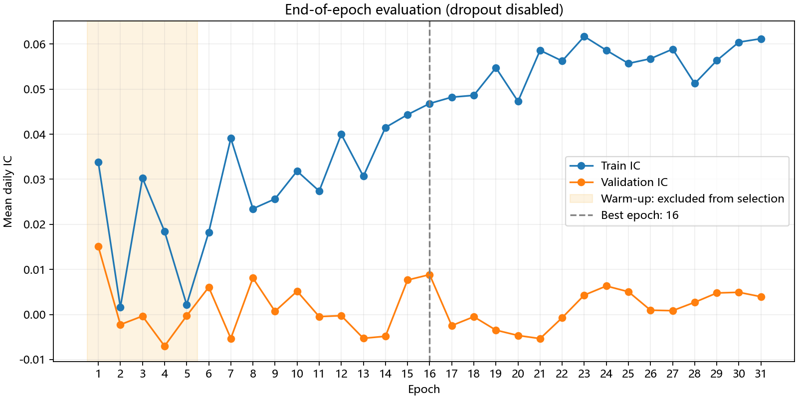

- [run/trials/V1_MASTER/attempt_001/epoch_metrics.csv](run__trials__V1_MASTER__attempt_001__epoch_metrics.csv)

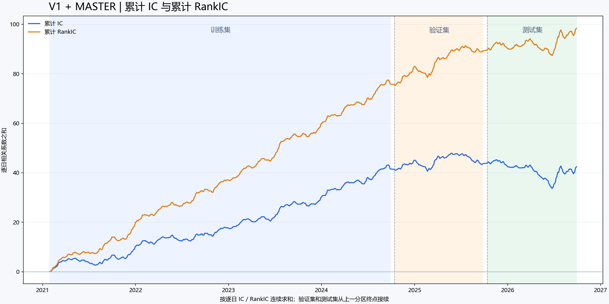

- [run/trials/V1_MASTER/attempt_001/metrics.json](run__trials__V1_MASTER__attempt_001__metrics.json)

| Metric | Value |
|---|---:|
| splits.train.mean_ic | 0.0468052 |
| splits.train.mean_rank_ic | 0.085421 |
| splits.valid.mean_ic | 0.00884526 |
| splits.valid.mean_rank_ic | 0.056487 |
| splits.test.mean_ic | -0.00525245 |
| splits.test.mean_rank_ic | 0.0387007 |

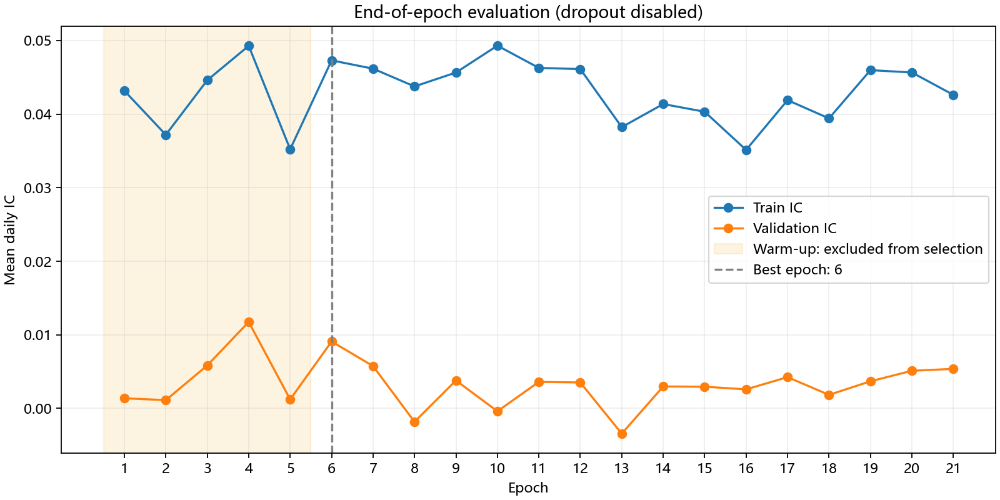

- [run/trials/V2_MASTER/attempt_001/epoch_metrics.csv](run__trials__V2_MASTER__attempt_001__epoch_metrics.csv)

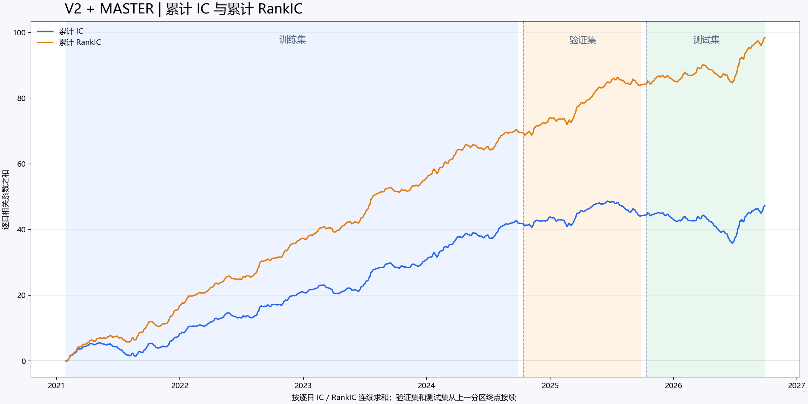

- [run/trials/V2_MASTER/attempt_001/metrics.json](run__trials__V2_MASTER__attempt_001__metrics.json)

| Metric | Value |
|---|---:|
| splits.train.mean_ic | 0.0473006 |
| splits.train.mean_rank_ic | 0.0785134 |
| splits.valid.mean_ic | 0.00909647 |
| splits.valid.mean_rank_ic | 0.0601805 |
| splits.test.mean_ic | 0.013024 |
| splits.test.mean_rank_ic | 0.0610277 |

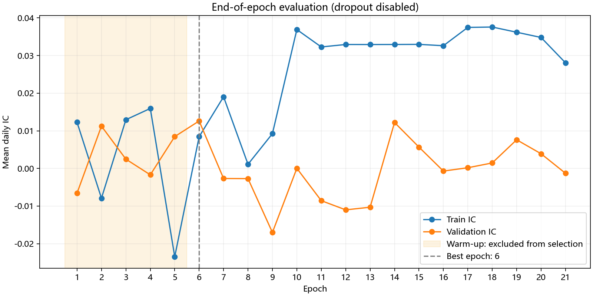

- [run/trials/V3_MASTER/attempt_001/epoch_metrics.csv](run__trials__V3_MASTER__attempt_001__epoch_metrics.csv)

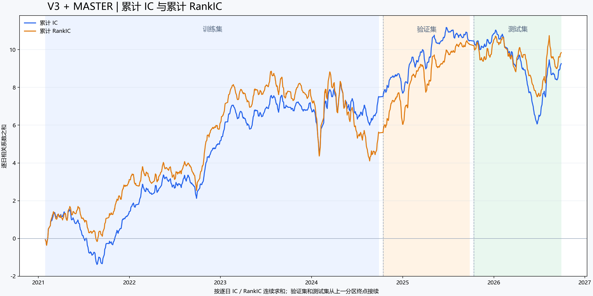

- [run/trials/V3_MASTER/attempt_001/metrics.json](run__trials__V3_MASTER__attempt_001__metrics.json)

| Metric | Value |
|---|---:|
| splits.train.mean_ic | 0.00843908 |
| splits.train.mean_rank_ic | 0.00629233 |
| splits.valid.mean_ic | 0.0126132 |
| splits.valid.mean_rank_ic | 0.0197989 |
| splits.test.mean_ic | -0.00516637 |
| splits.test.mean_rank_ic | -0.00184404 |

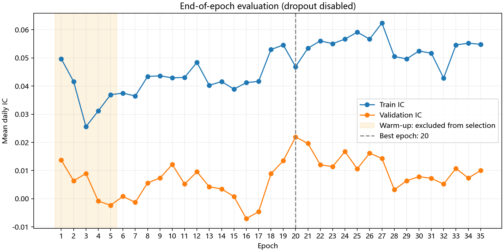

- [run/trials/V4_MASTER/attempt_001/epoch_metrics.csv](run__trials__V4_MASTER__attempt_001__epoch_metrics.csv)

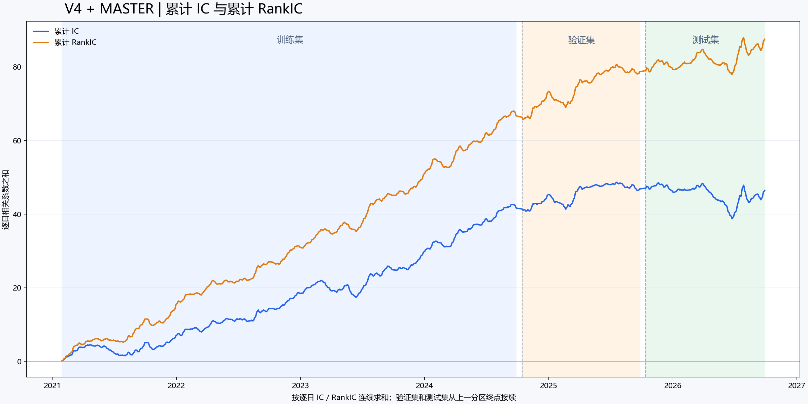

- [run/trials/V4_MASTER/attempt_001/metrics.json](run__trials__V4_MASTER__attempt_001__metrics.json)

| Metric | Value |
|---|---:|
| splits.train.mean_ic | 0.046891 |
| splits.train.mean_rank_ic | 0.0750892 |
| splits.valid.mean_ic | 0.021935 |
| splits.valid.mean_rank_ic | 0.0506093 |
| splits.test.mean_ic | -0.00174861 |
| splits.test.mean_rank_ic | 0.0372159 |

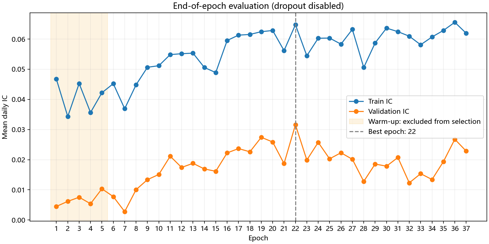

- [run/trials/V5_MASTER/attempt_001/epoch_metrics.csv](run__trials__V5_MASTER__attempt_001__epoch_metrics.csv)

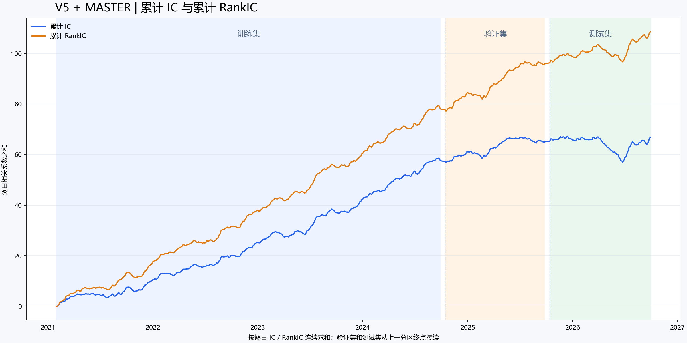

- [run/trials/V5_MASTER/attempt_001/metrics.json](run__trials__V5_MASTER__attempt_001__metrics.json)

| Metric | Value |
|---|---:|
| splits.train.mean_ic | 0.0647677 |
| splits.train.mean_rank_ic | 0.0878915 |
| splits.valid.mean_ic | 0.0315949 |
| splits.valid.mean_rank_ic | 0.0752001 |
| splits.test.mean_ic | 0.0077163 |
| splits.test.mean_rank_ic | 0.0536135 |

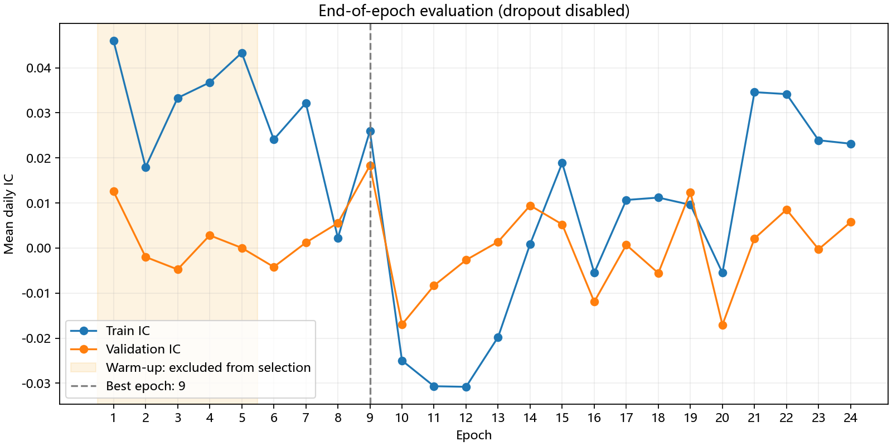

- [run/trials/V6_MASTER/attempt_001/epoch_metrics.csv](run__trials__V6_MASTER__attempt_001__epoch_metrics.csv)

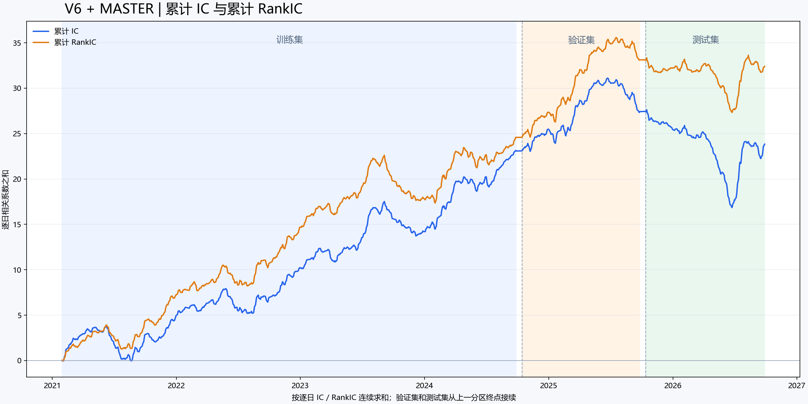

- [run/trials/V6_MASTER/attempt_001/metrics.json](run__trials__V6_MASTER__attempt_001__metrics.json)

| Metric | Value |
|---|---:|
| splits.train.mean_ic | 0.0259886 |
| splits.train.mean_rank_ic | 0.0276747 |
| splits.valid.mean_ic | 0.0183 |
| splits.valid.mean_rank_ic | 0.0360548 |
| splits.test.mean_ic | -0.015112 |
| splits.test.mean_rank_ic | -0.00304352 |
