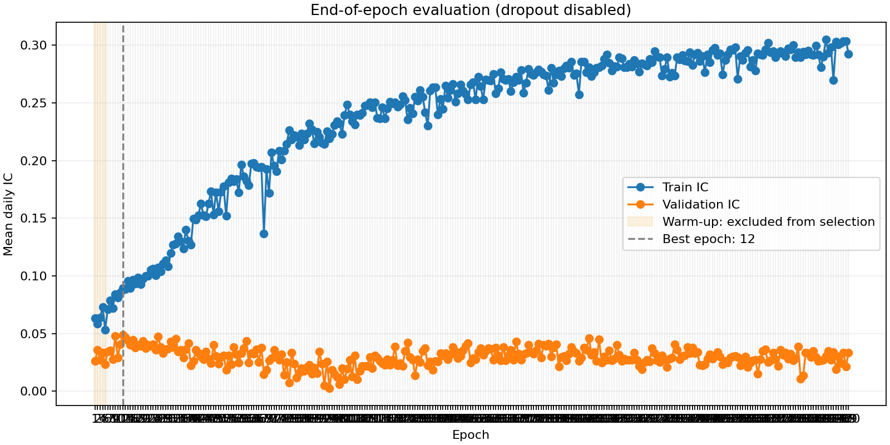
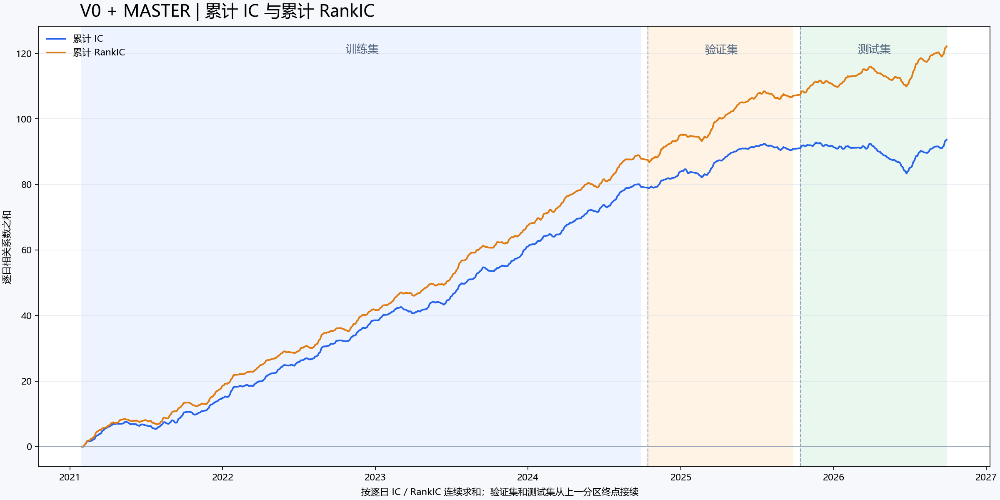
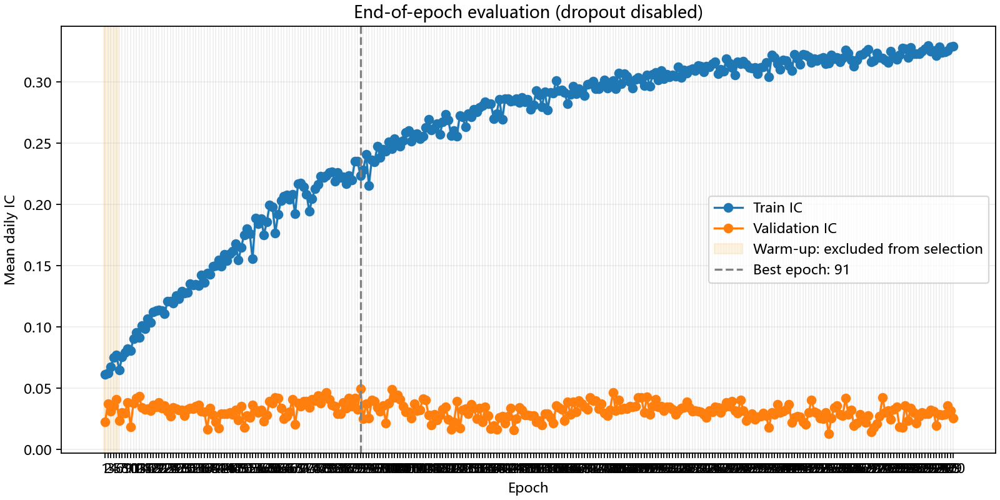
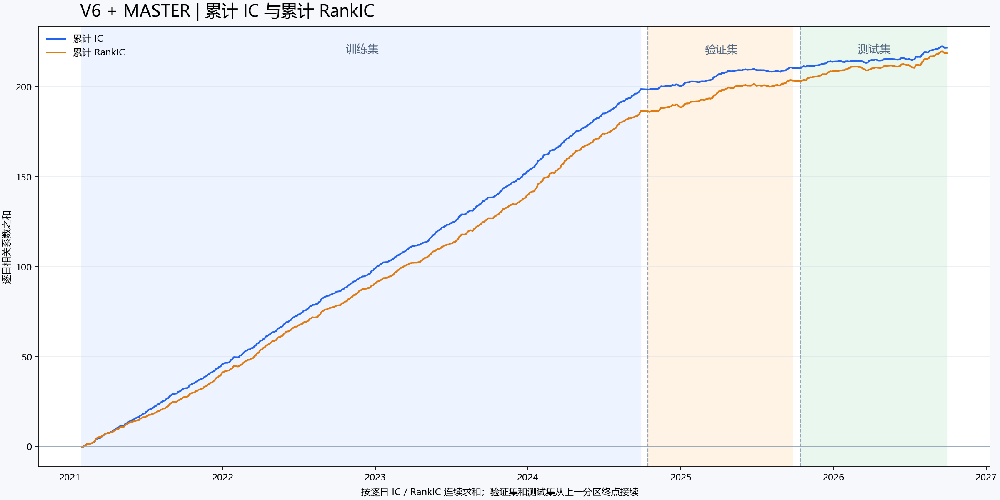

# zz1000-master-v0-v6-single-300-retry1-20261116-194743

Status: **completed** | Exit code: `0`

[Download complete results ZIP](https://github.com/ai-macro-quant/experiment-queue/releases/tag/result-zz1000-master-v0-v6-single-300-retry1-20261116-194743)

ZIP SHA256: `c6a8de716d408b9f95e27dcf7ffe6e12a08e329c7629e92ccfca8335f3a7db08`

- [run/summary.csv](run__summary.csv)

- [run/trials/V0_MASTER/attempt_001/epoch_metrics.csv](run__trials__V0_MASTER__attempt_001__epoch_metrics.csv)

- [run/trials/V0_MASTER/attempt_001/metrics.json](run__trials__V0_MASTER__attempt_001__metrics.json)

| Metric | Value |
|---|---:|
| splits.train.mean_ic | 0.0892553 |
| splits.train.mean_rank_ic | 0.0989572 |
| splits.valid.mean_ic | 0.0487199 |
| splits.valid.mean_rank_ic | 0.080805 |
| splits.test.mean_ic | 0.0120488 |
| splits.test.mean_rank_ic | 0.0637115 |

- [run/trials/V6_MASTER/attempt_001/epoch_metrics.csv](run__trials__V6_MASTER__attempt_001__epoch_metrics.csv)

- [run/trials/V6_MASTER/attempt_001/metrics.json](run__trials__V6_MASTER__attempt_001__metrics.json)

| Metric | Value |
|---|---:|
| splits.train.mean_ic | 0.223742 |
| splits.train.mean_rank_ic | 0.209982 |
| splits.valid.mean_ic | 0.0493897 |
| splits.valid.mean_rank_ic | 0.0715258 |
| splits.test.mean_ic | 0.0478136 |
| splits.test.mean_rank_ic | 0.0646363 |
